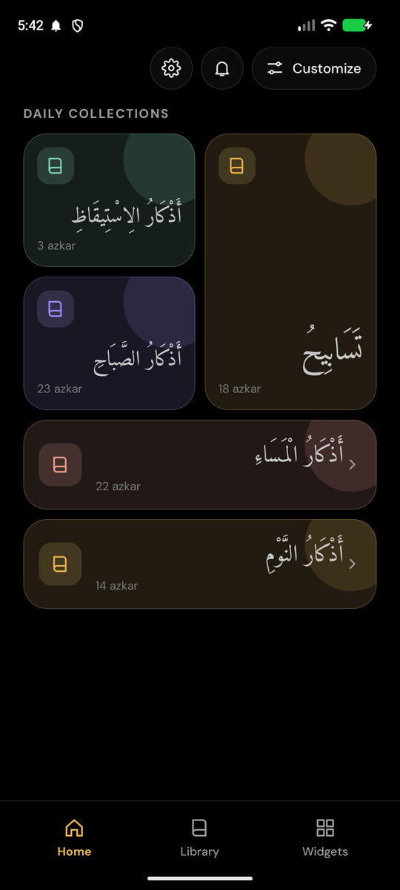
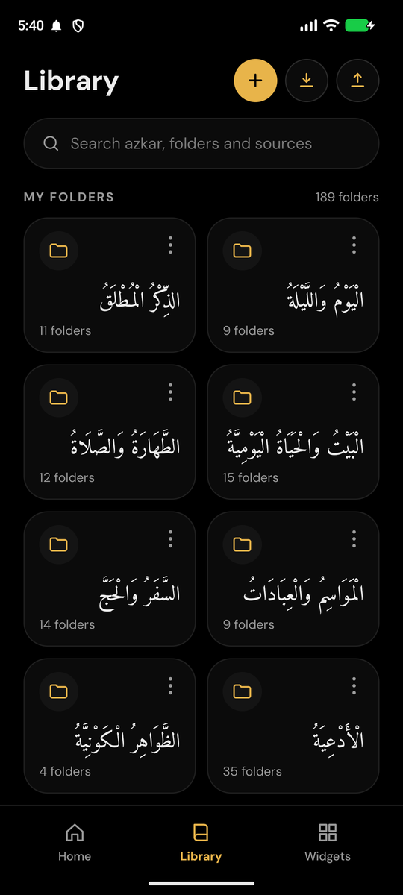
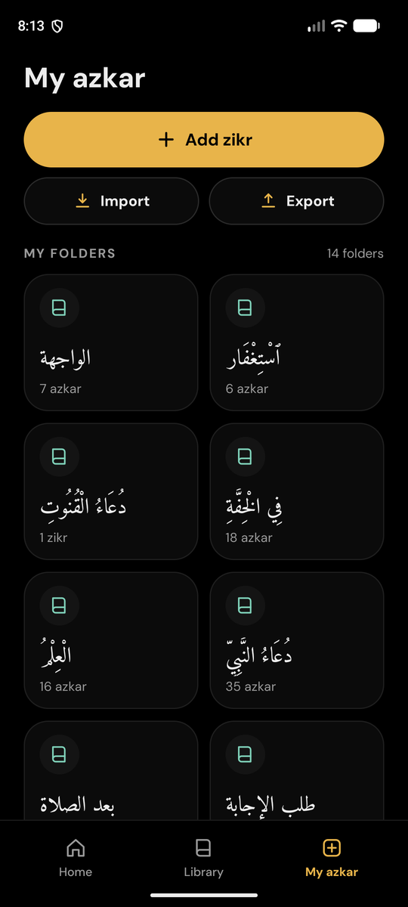
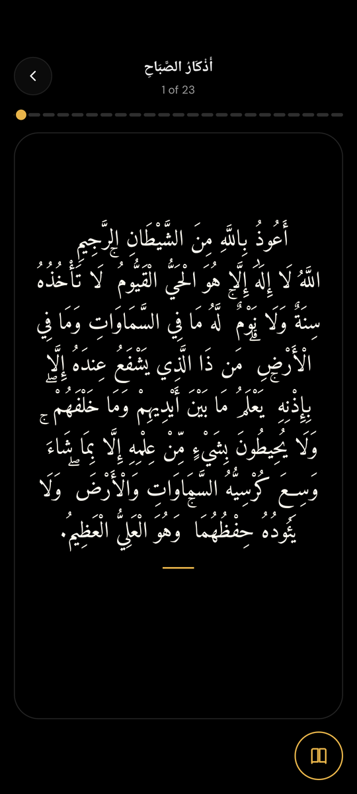
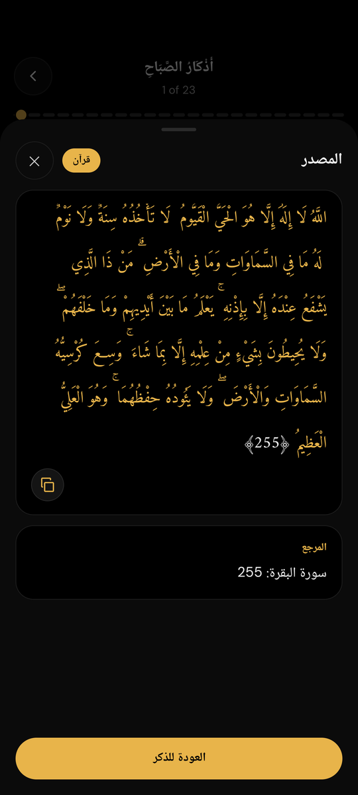
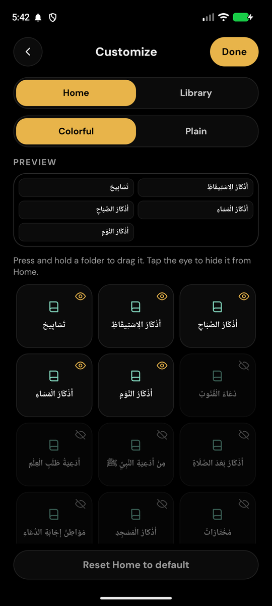
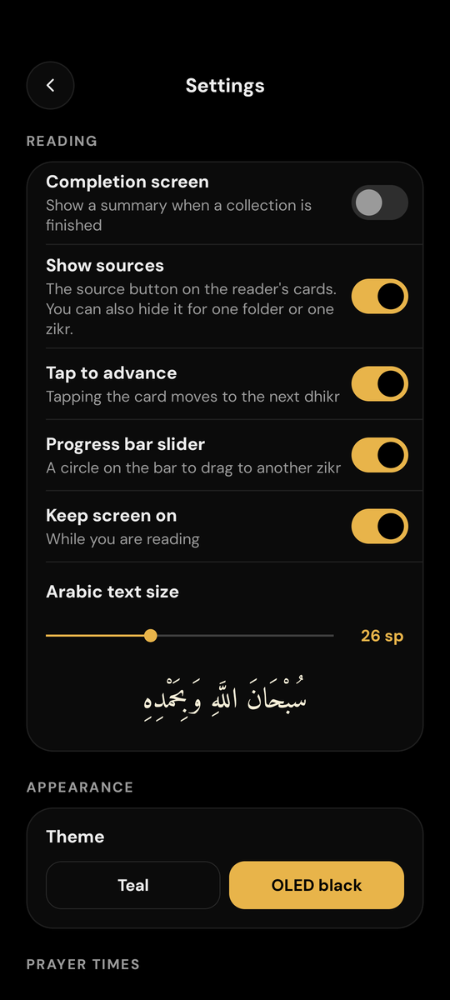
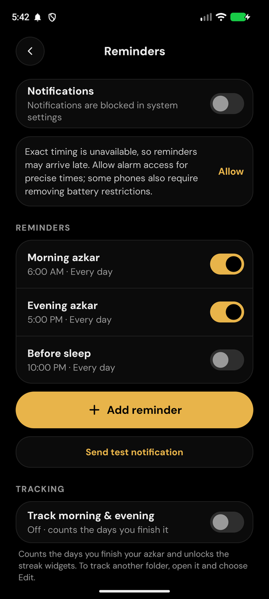

<p align="center">
  
</p>

<h1 align="center">Adhkar</h1>

<p align="center">
  A calm, offline Android app for reading, counting and organising your daily adhkar.<br>
  <b>Free and open source. No login, no subscription, no ads.</b>
</p>

## Why Adhkar

Most azkar apps need an account, show ads, or send data to a server. Adhkar does none of that. It has
no internet permission at all, so it can't track you or send anything anywhere. Your azkar, folders and
progress stay on your phone.

It comes with more than 850 azkar, most with their source from the Quran or the Sunnah, and you can add
your own: write any zikr or dua, choose how many times to repeat it, and organise it into your own folders.

## Screenshots

| Home | Library | My azkar |
| :---: | :---: | :---: |
|  |  |  |
| **Reader** | **Source of a zikr** | **Customize** |
|  |  |  |
| **Settings** | **Reminders** | |
|  |  | |

## Features

### Azkar
- **40 built-in collections, more than 850 azkar**: morning, evening, waking up, before sleep, after prayer,
  the prayer itself, tasabih, comprehensive duas, Quranic duas, duas of the prophets, the 99
  names of Allah, ruqyah, adhan, wudu, home, food, travel, hajj and umrah, completing the Quran, duas for
  the deceased, distress, istikhara, the sick, rain and wind, clothes, gatherings, anger, the market,
  when you are praised, and more
- **Add your own azkar**: write any zikr or dua, set its repeat count, give it a title, and put it in
  your own folders; edit, reorder or hide any folder, including the built-in ones
- **Search** the Library for azkar, folders and sources; folders can sit inside other folders
- Import and export your azkar as a JSON file; a backup also keeps your Home layout and hidden azkar

### Sources
- **Where each zikr comes from, one tap away**: the book button on the reader card turns it over to show
  the ayah, or the hadith text from the six books, with its reference and grade (al-Bukhari and Muslim,
  or al-Albani's grade for the Sunan)
- Azkar with no source in the Quran or Sunnah have no source button
- Hide sources for one zikr (in Edit folder), for a folder, or for the whole app (Settings)

### Reading
- Focused Arabic reader: tap to advance, counters, notes, titles above or below the zikr, a progress
  slider you can drag, adjustable text size and keep-screen-on
- Folders can remember where you stopped and start over at a moment you choose: before or after any
  prayer, or at midnight (morning azkar start over at Dhuhr and evening azkar at Maghrib by default)
- Finishing a folder takes you back to where you opened it: Home, Library or My azkar

### Reminders and tracking
- Reminders for morning, evening and before sleep; they can follow prayer times for your approximate
  location, or a city or coordinates you set by hand (no location permission needed), with a choice of
  calculation method (Egyptian, Umm al-Qura, MWL, ISNA and more) and the standard or Hanafi Asr time;
  your own reminders can come at a set time or before / after any prayer
- Optional tracking of the days you finish your azkar, with streaks
- **Prayer times are approximate.** The app is not a prayer-times app, so the exact time of salat it shows may not be
  100% correct. It is only used to time reminders and widgets; for the exact time, follow your local mosque or a
  dedicated prayer-times app

### Widgets and look
- **Two looks for Home**: a bento layout with a big card, a wide card and small cards, in colour (one tint
  per collection, the default) or plain; choose it in Customize
- Home-screen widgets in many sizes and styles, including tap-to-count; widgets and the reader share
  their progress; a redesigned Widgets screen and Add widget sheet show each widget to scale on a
  home-screen strip
- Full Arabic interface on Arabic phones (RTL), OLED black or teal theme, bundled Amiri and DM Sans fonts

## Install

1. Open the [Releases page](../../releases) and download the latest `Adhkar-<version>.apk`.
2. Open the file on your phone. Android will ask you to allow installing apps from your browser or
   file manager; allow it for this install.
3. Requires Android 8.0 or newer.

## Privacy

| | |
| --- | --- |
| Internet access | **None.** The app does not request the `INTERNET` permission, so it cannot send or receive data. |
| Ads, analytics, tracking | None. No third-party SDKs for ads, analytics or crash reporting. |
| Account | None needed. |
| Location | Optional, approximate only (`ACCESS_COARSE_LOCATION`). Used on the phone to calculate prayer times for reminders. Deny it and choose a city or enter coordinates instead, or keep the fixed times. |
| Notifications | Only for the reminders you turn on. |
| Your data | Stored on the phone only. If you turn on Android's own backup, Android may include the app's data (azkar, settings, last approximate location) in your Google backup. |

Other permissions: `RECEIVE_BOOT_COMPLETED` (to restore reminders after a restart) and
`SCHEDULE_EXACT_ALARM` (to deliver reminders on time).

## Build from source

Requirements: JDK 17 and the Android SDK with platform 37 (Android Studio includes both).

```bash
./gradlew assembleDebug      # app/build/outputs/apk/debug/Adhkar-<version>-debug.apk
./gradlew assembleRelease    # app/build/outputs/apk/release/Adhkar-<version>.apk
```

On Windows use `gradlew.bat`. Without a `keystore.properties` file the release APK is unsigned. To sign it,
copy `keystore.properties.example` to `keystore.properties` and fill in your own key; that file and any
`.jks` key are git-ignored.

## Tests

```bash
./gradlew testDebugUnitTest          # unit tests (prayer times, reminders, reader, import, tracking, widgets, sources)
./gradlew lintDebug                  # Android lint
./gradlew connectedDebugAndroidTest  # instrumented tests on a device or emulator (database, import/export, widgets)
```

Note: `connectedDebugAndroidTest` uninstalls the app from the device afterwards, which deletes its data.
CI runs the unit tests and lint on every push, and the instrumented tests on an emulator.

## Releasing

1. Raise `versionCode` and set `versionName` in `app/build.gradle.kts`, then commit.
2. Optionally write the release text in `docs/release-notes/v<version>.md`; without it, GitHub generates notes.
3. Push a tag named after the version, for example `git tag v2.0 && git push origin v2.0`.

The Release workflow builds the APK, checks it is signed with the release key, and publishes it as a
GitHub release. It needs four repository secrets: `RELEASE_KEYSTORE_BASE64` (the `.jks` file,
base64-encoded), `RELEASE_STORE_PASSWORD`, `RELEASE_KEY_ALIAS` and `RELEASE_KEY_PASSWORD`.

## Contributing

Issues and pull requests are welcome. Please keep the app offline and free of tracking, run the unit
tests and lint before opening a pull request, and describe how you tested your change.

## License

[MIT](LICENSE) © 2026 Adhkar
